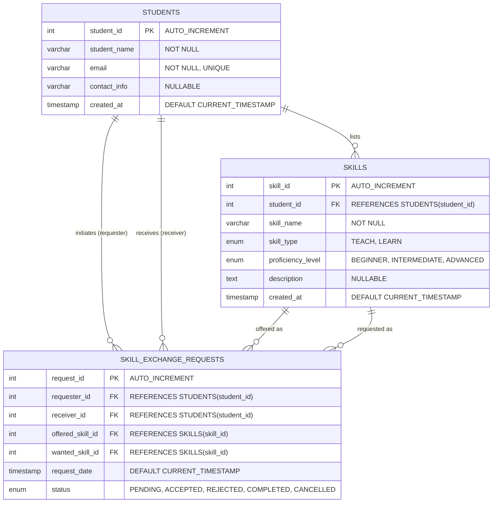

# SkillSwap – Student Skill Exchange

[](https://openjdk.org/)
[](https://maven.apache.org/)
[](https://www.mysql.com/)
[](https://dev.mysql.com/doc/connector-j/en/)
[](https://junit.org/junit5/)
[]()
[]()

> A robust, database-connected peer-to-peer knowledge exchange platform built using **Core Java (Java 17 LTS)**, **Maven**, **JDBC**, and **MySQL 8.0**. Designed for university and college students to trade practical skills without financial costs.

---

## Table of Contents

1. [Project Overview & Motivation](#1-project-overview--motivation)
2. [Key Features](#2-key-features)
3. [System Architecture](#3-system-architecture)
4. [Database Design & ER Schema](#4-database-design--er-schema)
5. [Smart Skill Matching Algorithm](#5-smart-skill-matching-algorithm)
6. [Technology Stack](#6-technology-stack)
7. [Installation & Setup Guide](#7-installation--setup-guide)
8. [Running the Application](#8-running-the-application)
9. [Console Menu Walkthrough](#9-console-menu-walkthrough)
10. [Automated Testing & Security Validation](#10-automated-testing--security-validation)
11. [15-Scenario Manual Testing Checklist](#11-15-scenario-manual-testing-checklist)
12. [DBMS Viva & Technical Interview Q&A](#12-dbms-viva--technical-interview-qa)
13. [Future Enhancements](#13-future-enhancements)

---

## 1. Project Overview & Motivation

In modern academic environments, students possess diverse specialized proficiencies ranging from software engineering (Java, Python, C++) to digital arts (UI/UX Design, Video Editing, Motion Graphics). However, high commercial course fees and lack of structured barter networks often deter cross-disciplinary learning.

**SkillSwap – Student Skill Exchange** provides a decentralized, cashless knowledge-sharing ecosystem where students barter competencies:
- **Example**: Student A knows *Java* and wants to learn *UI/UX Design*. Student B is skilled in *UI/UX Design* and wants to master *Java*. SkillSwap detects this reciprocal pairing, connects the students, and manages their collaborative exchange lifecycle.

The application is built strictly with **Core Java**, **native JDBC (`mysql-connector-j`)**, and **MySQL 8.0**, adhering to standard multi-tier design patterns without relying on heavy abstractions like Spring Boot, Hibernate, or ORM frameworks.

---

## 2. Key Features

- **Student Identity & Session Context**:
  - Validated student registration enforcing unique emails, RFC-compliant email formatting, and boundary protections.
  - Interactive session switching simulating active logged-in student state for frictionless evaluation.

- **Dual Skill Portfolio (TEACH & LEARN)**:
  - Students register skills they can **TEACH** or desire to **LEARN** with defined proficiencies (`BEGINNER`, `INTERMEDIATE`, `ADVANCED`).
  - Intelligent input normalization: automatic whitespace collapsing, sentence casing, and acronym preservation (`UI/UX`, `C++`, `Node.js`).
  - Strict duplicate prevention per student and skill type.

- **Rule-Based Smart Skill Matching**:
  - **Mutual Matches**: Identifies reciprocal exchange pairs using relational 5-way SQL joins.
  - **Partial (One-Way) Matches**: Identifies mentors who teach what you want to learn, providing contact points for prospective exchanges.

- **Exchange Request Lifecycle & Concurrency**:
  - Comprehensive finite-state machine: `PENDING` $\rightarrow$ `ACCEPTED` / `REJECTED` $\rightarrow$ `COMPLETED` / `CANCELLED`.
  - Concurrency-safe status updates preventing race conditions.
  - Active request protection preventing students from deleting or editing skills currently committed in ongoing exchanges.

- **Live Analytics & Platform Reporting**:
  - Instant aggregate summary displaying total registered students, categorized skills distribution, and request lifecycle breakdown.

---

## 3. System Architecture

The project adheres to a clean, decoupled **Multi-Tier Architecture**:

```
[ Console UI (CLI) ]  <--->  [ Service Layer (Business Rules & Validation) ]
                                       |
                                       v
                             [ Data Access Layer (DAOs) ]
                                       |
                                       v
                             [ JDBC Driver (MySQL Connector/J) ]
                                       |
                                       v
                             [ MySQL Database (skillswap) ]
```

### Package Directory Structure

```
DBMS Skill Swap Project/
├── database/
│   ├── schema.sql                 # Complete MySQL DDL tables, keys, and indexes
│   └── sample_data.sql            # Seed data (5 students, 19 skills, 3 requests)
├── src/
│   ├── main/
│   │   ├── java/com/skillswap/
│   │   │   ├── config/            # Database connection & connection pool lifecycle
│   │   │   │   └── DatabaseConnection.java
│   │   │   ├── dao/               # Data Access Objects (pure JDBC + PreparedStatements)
│   │   │   │   ├── SkillDAO.java
│   │   │   │   ├── SkillExchangeRequestDAO.java
│   │   │   │   └── StudentDAO.java
│   │   │   ├── model/             # Domain POJOs & Enums
│   │   │   │   ├── PlatformReport.java
│   │   │   │   ├── ProficiencyLevel.java
│   │   │   │   ├── RequestStatus.java
│   │   │   │   ├── Skill.java
│   │   │   │   ├── SkillMatch.java
│   │   │   │   ├── SkillType.java
│   │   │   │   └── Student.java
│   │   │   ├── service/           # Business logic, validations, matching, lifecycle
│   │   │   │   ├── ExchangeService.java
│   │   │   │   ├── ReportService.java
│   │   │   │   ├── SkillMatchingService.java
│   │   │   │   ├── SkillService.java
│   │   │   │   └── StudentService.java
│   │   │   ├── ui/                # ANSI Console user interface & input parser
│   │   │   │   └── ConsoleMenu.java
│   │   │   ├── util/              # String sanitizers, RFC regex, normalizers
│   │   │   │   ├── InputValidator.java
│   │   │   │   └── SkillNormalizer.java
│   │   │   └── Main.java          # Application entry point
│   │   └── resources/
│   │       ├── db.properties.example # Tracked template configuration
│   │       └── db.properties         # Gitignored active credentials
│   └── test/java/com/skillswap/
│       ├── config/
│       │   ├── DatabaseConnectionTest.java
│       │   └── DatabaseSeeder.java
│       ├── service/
│       │   ├── EdgeCaseTest.java
│       │   ├── ExchangeServiceTest.java
│       │   ├── ReportServiceTest.java
│       │   ├── SkillMatchingServiceTest.java
│       │   ├── SkillServiceTest.java
│       │   └── StudentServiceTest.java
│       └── ui/
│           └── ConsoleMenuTest.java
├── pom.xml                        # Maven dependencies & build plugins
├── .gitignore                     # Git rules (db.properties, target/, IDE files)
└── README.md                      # Comprehensive project documentation
```

---

## 4. Database Design & ER Schema

### Entity-Relationship Diagram



### Table Definitions & Referential Actions

1. **`STUDENTS`**:
   - Primary Key: `student_id` (Auto-increment).
   - Natural Key: `email` (Unique, case-insensitive index).
   - Check Constraints: `CHAR_LENGTH(TRIM(student_name)) > 0`, `CHAR_LENGTH(TRIM(email)) > 0`.

2. **`SKILLS`**:
   - Primary Key: `skill_id`.
   - Foreign Key: `student_id` $\rightarrow$ `STUDENTS(student_id)` on `DELETE CASCADE` on `UPDATE CASCADE`.
   - Unique Composite Constraint: `(student_id, skill_name, skill_type)` prevents duplicate skill entries under the same type for a student.
   - Performance Indexes:
     - `idx_skills_name_type ON SKILLS(skill_name, skill_type)` (speeds up matching joins).
     - `idx_skills_student_type ON SKILLS(student_id, skill_type)` (speeds up student portfolio filtering).

3. **`SKILL_EXCHANGE_REQUESTS`**:
   - Primary Key: `request_id`.
   - Foreign Keys:
     - `requester_id` $\rightarrow$ `STUDENTS(student_id)` (`ON DELETE CASCADE`).
     - `receiver_id` $\rightarrow$ `STUDENTS(student_id)` (`ON DELETE CASCADE`).
     - `offered_skill_id` $\rightarrow$ `SKILLS(skill_id)` (`ON DELETE RESTRICT`).
     - `wanted_skill_id` $\rightarrow$ `SKILLS(skill_id)` (`ON DELETE RESTRICT`).
   - Performance Indexes:
     - `idx_req_requester_status ON SKILL_EXCHANGE_REQUESTS(requester_id, status)`.
     - `idx_req_receiver_status ON SKILL_EXCHANGE_REQUESTS(receiver_id, status)`.

---

## 5. Smart Skill Matching Algorithm

Rather than relying on ungrounded AI/ML claims, SkillSwap utilizes **relational database joins** to deterministically identify compatible exchange partners in constant logarithmic lookup time ($O(\log N)$):

### Mutual Match Query (5-Way Relational Join)

```sql
SELECT DISTINCT
    b.student_id AS partner_id,
    b.student_name AS partner_name,
    b.email AS partner_email,
    b.contact_info AS partner_contact,
    s_a_teach.skill_id AS my_teach_skill_id,
    s_a_teach.skill_name AS my_teach_skill_name,
    s_a_teach.proficiency_level AS my_teach_level,
    s_b_teach.skill_id AS partner_teach_skill_id,
    s_b_teach.skill_name AS partner_teach_skill_name,
    s_b_teach.proficiency_level AS partner_teach_level
FROM STUDENTS b
-- 1. Student A's TEACH skills
JOIN SKILLS s_a_teach ON s_a_teach.student_id = ? AND s_a_teach.skill_type = 'TEACH'
-- 2. Partner B's LEARN skills matching Student A's TEACH skill
JOIN SKILLS s_b_learn ON s_b_learn.student_id = b.student_id AND s_b_learn.skill_type = 'LEARN' 
     AND LOWER(TRIM(s_a_teach.skill_name)) = LOWER(TRIM(s_b_learn.skill_name))
-- 3. Student A's LEARN skills
JOIN SKILLS s_a_learn ON s_a_learn.student_id = ? AND s_a_learn.skill_type = 'LEARN'
-- 4. Partner B's TEACH skills matching Student A's LEARN skill
JOIN SKILLS s_b_teach ON s_b_teach.student_id = b.student_id AND s_b_teach.skill_type = 'TEACH' 
     AND LOWER(TRIM(s_a_learn.skill_name)) = LOWER(TRIM(s_b_teach.skill_name))
WHERE b.student_id <> ?
ORDER BY b.student_name ASC;
```

### Why Relational DBMS Matching Excels:
1. **Mathematical Soundness**: Mutual exchange requires $A_{teach} = B_{learn} \land B_{teach} = A_{learn}$. An inner join guarantees 100% exactness without false positives or hallucinated partners.
2. **Execution Efficiency**: Leveraging composite B-Tree indexes on `(skill_name, skill_type)` avoids full table scans, executing in milliseconds even across thousands of records.
3. **Auditability**: Results can be independently verified via standard SQL queries by an examiner or database administrator.

---

## 6. Technology Stack

| Layer | Component | Version | Rationale |
| :--- | :--- | :--- | :--- |
| **Language** | Java (OpenJDK) | 17 LTS | Modern LTS Java featuring text blocks, switch expressions, and records |
| **Build Tool** | Apache Maven | 3.9+ | Standard dependency resolution, test automation, and packaging |
| **Database** | MySQL Community Server | 8.0+ | ACID-compliant RDBMS with robust InnoDB transactional engine |
| **Driver** | MySQL Connector/J | 8.3.0 | Official Type 4 JDBC driver with prepared statement caching |
| **Testing** | JUnit Jupiter | 5.10.2 | Comprehensive unit, edge-case, and security test runner |

---

## 7. Installation & Setup Guide

### Step 1: Clone the Repository
```bash
git clone https://github.com/Sandhanakumar-B/DBMS-Skill-Swap-Project.git
cd "DBMS Skill Swap Project"
```

### Step 2: Set Up MySQL Database
Open your MySQL Workbench, MySQL Shell, or command line client:
```sql
SOURCE database/schema.sql;
SOURCE database/sample_data.sql;
```
*(Alternatively, execute the statements in `database/schema.sql` and `database/sample_data.sql` inside your SQL client).*

### Step 3: Configure Database Credentials
Create `src/main/resources/db.properties` (or place `db.properties` in the project root directory):
```properties
db.url=jdbc:mysql://localhost:3306/skillswap?useSSL=false&allowPublicKeyRetrieval=true&serverTimezone=UTC
db.user=root
db.password=YOUR_MYSQL_PASSWORD_HERE
```
> [!NOTE]
> `db.properties` is protected by `.gitignore` to prevent committing plaintext credentials to public repositories.

### Step 4: Verify Build & Run Automated Tests
```bash
mvn clean test
```
Expected output: **47 tests run, 0 failures, 0 errors, BUILD SUCCESS**.

---

## 8. Running the Application

Execute the application directly through Maven:
```bash
mvn exec:java
```

Or build an executable `.jar` package:
```bash
mvn clean package
java -cp target/skillswap-1.0-SNAPSHOT.jar com.skillswap.Main
```

---

## 9. Console Menu Walkthrough

When launched, SkillSwap presents a full-featured console dashboard:

```
==================================================
       SKILLSWAP - STUDENT SKILL EXCHANGE         
==================================================
 ACTIVE USER: [No Student Selected - Demonstrating as Guest]
==================================================
 1. Register Student
 2. Switch / Select Active Student
 3. View My Profile
 4. Add Skill (TEACH or LEARN)
 5. View / Manage My Skills
 6. Search Skills
 7. Find Smart Matches
 8. Send Exchange Request
 9. View Incoming Requests
 10. Accept Incoming Request
 11. Reject Incoming Request
 12. View Outgoing Requests
 13. Cancel Exchange Request
 14. Complete Exchange
 15. View All Registered Students
 16. View Application Summary Report
 0. Exit
--------------------------------------------------
Enter your choice (0-16):
```

### Sample Operations:
- **Switch Active User**: Choose Option `2` and enter Student ID `1` (Alice Sharma).
- **Find Smart Matches**: Choose Option `7` to see mutual matches with Bob Chen (Java $\leftrightarrow$ UI/UX Design).
- **Send Exchange Request**: Choose Option `8` to propose an exchange.
- **View Platform Report**: Choose Option `16` to view platform statistics.

---

## 10. Automated Testing & Security Validation

The test suite contains **47 automated tests** across 8 test classes verifying both functional specifications and defensive edge cases:

```
-------------------------------------------------------
 T E S T S
-------------------------------------------------------
Running com.skillswap.config.DatabaseConnectionTest      [2 tests  - OK]
Running com.skillswap.service.EdgeCaseTest              [13 tests - OK]
Running com.skillswap.service.ExchangeServiceTest       [11 tests - OK]
Running com.skillswap.service.ReportServiceTest          [1 test   - OK]
Running com.skillswap.service.SkillMatchingServiceTest   [3 tests  - OK]
Running com.skillswap.service.SkillServiceTest           [8 tests  - OK]
Running com.skillswap.service.StudentServiceTest         [7 tests  - OK]
Running com.skillswap.ui.ConsoleMenuTest                 [2 tests  - OK]

Results:
Tests run: 47, Failures: 0, Errors: 0, Skipped: 0
BUILD SUCCESS
```

### Key Security & Boundary Protections Verified:
1. **SQL Injection Resistance**:
   - Parameterized queries tested with injection strings: `' OR '1'='1`, `Robert'); DROP TABLE STUDENTS;--`.
   - Handled as literal strings with 100% database schema protection.
2. **Active Request Constraint Integrity**:
   - Skills tied to ongoing `PENDING` or `ACCEPTED` requests cannot be edited or deleted until the request reaches a terminal status (`COMPLETED`, `REJECTED`, or `CANCELLED`).
3. **State Transition Concurrency**:
   - Conditional atomic SQL updates (`UPDATE ... WHERE request_id = ? AND status = ?`) block invalid status transitions or race conditions.
4. **Boundary Limit Checks**:
   - Prevents unhandled database truncation errors by validating input lengths (`student_name` $\le$ 100, `email` $\le$ 150, `skill_name` $\le$ 100).

---

## 11. 15-Scenario Manual Testing Checklist

| # | Feature / Scenario | Input Steps in CLI | Expected Result | Verified |
|---|--------------------|--------------------|-----------------|:--------:|
| **1** | Valid Registration | Menu `1` $\rightarrow$ Name: `David Miller`, Email: `david@univ.edu`, Contact: `555-0199` | Student created with ID; auto-selected as active user. | ✅ |
| **2** | Blank Name Validation | Menu `1` $\rightarrow$ Name: `   ` | Error: `Student name cannot be blank.` | ✅ |
| **3** | Invalid Email Format | Menu `1` $\rightarrow$ Name: `Bob`, Email: `invalid-email` | Error: `Invalid email format`. Registration rejected. | ✅ |
| **4** | Duplicate Email | Menu `1` $\rightarrow$ Name: `David Copy`, Email: `david@univ.edu` | Error: `Email is already registered.` | ✅ |
| **5** | Switch Active User | Menu `2` $\rightarrow$ Enter ID `1` (Alice Sharma) | Header updates: `ACTIVE USER: [Alice Sharma (ID: 1)]`. | ✅ |
| **6** | Add TEACH & LEARN Skills | Menu `4` $\rightarrow$ `Docker` (`TEACH`, `ADVANCED`), `Kubernetes` (`LEARN`, `BEGINNER`) | Normalized and persisted under Menu `5`. | ✅ |
| **7** | Duplicate Skill Prevention | Menu `4` $\rightarrow$ `  docker  ` (`TEACH`) | Error: `You have already added 'Docker' as a TEACH skill.` | ✅ |
| **8** | Keyword Skill Search | Menu `6` $\rightarrow$ Keyword: `java` | Lists all matching skills, proficiencies, and teacher names. | ✅ |
| **9** | Mutual Smart Match | Switch to Alice (`1`) $\rightarrow$ Menu `7` | Shows `[MUTUAL MATCH #1]` with Bob Chen (`Java` $\leftrightarrow$ `UI/UX Design`). | ✅ |
| **10**| Send Exchange Request | Menu `8` $\rightarrow$ Receiver `2`, Offered `1` (`Java`), Wanted `5` (`UI/UX`) | Request created with `PENDING` status. | ✅ |
| **11**| Reject Self-Request | Menu `8` $\rightarrow$ Enter Alice's own ID as receiver | Error: `Cannot send a skill exchange request to yourself.` | ✅ |
| **12**| Block Invalid Skill Offering | Menu `8` $\rightarrow$ Try offering Bob's skill or a `LEARN` skill | Error: `You can only offer skills that you can TEACH.` | ✅ |
| **13**| Accept Incoming Request | Switch to Bob (`2`) $\rightarrow$ Menu `10` $\rightarrow$ Enter Request ID | Status transitions from `PENDING` to `ACCEPTED`. | ✅ |
| **14**| Complete Exchange | Menu `14` $\rightarrow$ Enter Request ID | Status transitions from `ACCEPTED` to `COMPLETED`. | ✅ |
| **15**| Platform Summary Report | Menu `16` | Displays live counts of students, skills, and requests by status. | ✅ |

---

## 12. DBMS Viva & Technical Interview Q&A

### Q1: What is the relationship between the three tables?
- **Answer**:
  - `STUDENTS` to `SKILLS` is a **1-to-Many ($1:N$)** relationship: One student can list multiple skills to teach and learn.
  - `STUDENTS` to `SKILL_EXCHANGE_REQUESTS` has **two 1-to-Many relationships**: One for the `requester_id` and one for the `receiver_id`.
  - `SKILLS` to `SKILL_EXCHANGE_REQUESTS` has **two 1-to-Many relationships**: One for `offered_skill_id` and one for `wanted_skill_id`.
  - The `SKILL_EXCHANGE_REQUESTS` table serves as a relational bridge capturing transactions between two students and their respective skills.

### Q2: Why did you choose raw JDBC over an ORM like Hibernate or Spring Data JPA?
- **Answer**:
  - **Educational Rigor & Transparency**: Raw JDBC demonstrates direct mastery of SQL fundamentals, transaction handling, connection pooling, and `PreparedStatement` lifecycle without hidden layers.
  - **Predictable Performance**: Custom SQL queries (such as the 5-way join for smart skill matching) execute without the overhead of N+1 query problems, second-level cache latency, or heavy reflection frameworks.
  - **Zero Bloat**: Keeps the distribution lightweight ($\approx 10$ MB build artifacts instead of $60+$ MB with Spring Boot).

### Q3: How does the application safeguard against SQL Injection?
- **Answer**:
  - Every SQL interaction across all DAOs (`StudentDAO`, `SkillDAO`, `SkillExchangeRequestDAO`) uses `PreparedStatement` with indexed parameter placeholders (`?`).
  - Values are sent separately from the SQL statement in binary format; the MySQL server precompiles the query template, ensuring user input is treated strictly as data literals and can never alter query execution semantics.

### Q4: How is data consistency and concurrency preserved during status updates?
- **Answer**:
  - We employ **Optimistic Concurrency Control** via conditional SQL statements:
    ```sql
    UPDATE SKILL_EXCHANGE_REQUESTS
    SET status = ?
    WHERE request_id = ? AND status = ?;
    ```
  - If two users or threads attempt to accept and reject the same request concurrently, only the first transaction modifies the row (affected rows = 1); the subsequent transaction finds `status` already changed (affected rows = 0) and fails gracefully with an `IllegalStateException`.

### Q5: Why is `requester_id <> receiver_id` enforced in Java rather than MySQL `CHECK` constraints?
- **Answer**:
  - In MySQL 8.0, `CHECK (requester_id <> receiver_id)` raises **Error 3823** if the columns are referenced by foreign keys with referential actions (`ON DELETE CASCADE`). To preserve clean cascading student deletions while maintaining zero self-requests, the constraint is strictly enforced in the Service layer (`ExchangeService.java`).

### Q6: What happens if a student attempts to delete a skill currently in an active exchange?
- **Answer**:
  - The application provides a dual-layer defense:
    1. **Service Layer Guard**: `SkillService.deleteSkill()` inspects whether the skill is referenced in any request with status `PENDING` or `ACCEPTED` and throws a descriptive `IllegalStateException`.
    2. **Database Layer Guard**: Foreign keys `fk_req_offered_skill` and `fk_req_wanted_skill` specify `ON DELETE RESTRICT`, preventing orphan transactions at the engine level.

---

## 13. Future Enhancements

1. **Email & WebSocket Notifications**: Instant notification alerts when an exchange request is received, accepted, or completed.
2. **Student Rating & Review System**: Post-exchange feedback scoring (1–5 stars) to build student credibility scores.
3. **Web / Mobile Front-End**: Expose REST endpoints via a lightweight web framework or Next.js frontend while retaining the decoupled JDBC backend.
4. **Time Banking & Session Booking**: Integration of Google Calendar links and session credit tracking.

---

## License

This project is licensed under the **MIT License** — free for academic, personal, and educational use.

## Author

Developed for the **Database Management Systems (DBMS)** academic curriculum.  
**Repository**: [DBMS-Skill-Swap-Project](https://github.com/Sandhanakumar-B/DBMS-Skill-Swap-Project)
